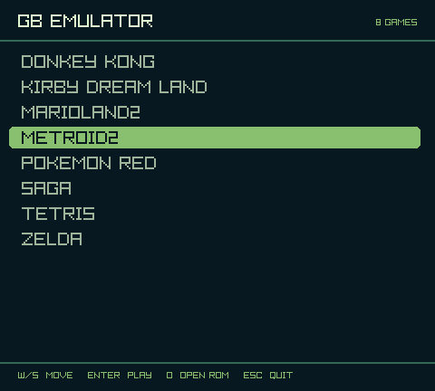
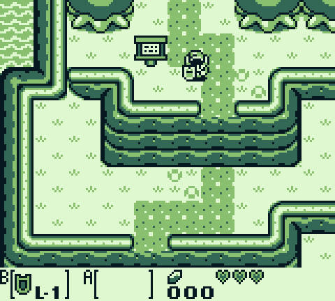
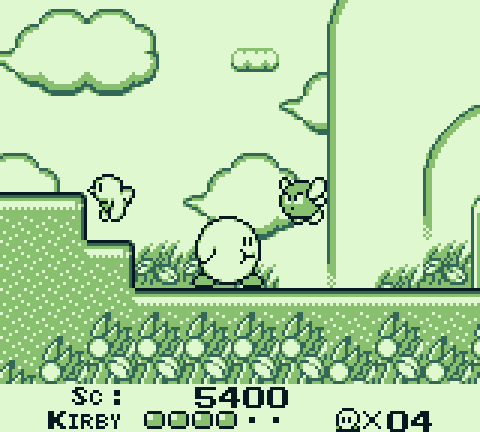
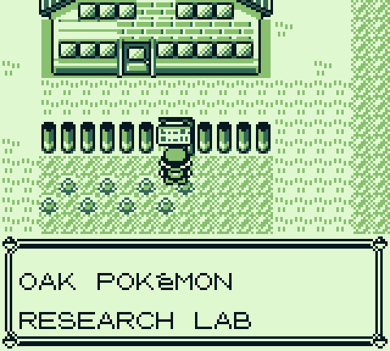
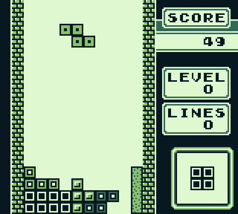
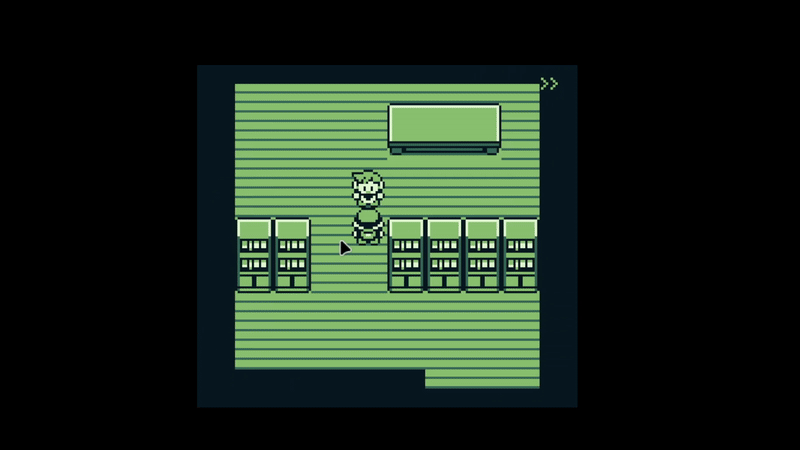

# Game Boy Emulator

A DMG (original Game Boy) emulator written in C++ with [raylib](https://www.raylib.com/) for video, audio, and input.

## Screenshots

|                Library                |              Link's Awakening              |       Kirby's Dream Land        |
| :-----------------------------------: | :----------------------------------------: | :-----------------------------: |
|       |       |       |

|               Pokémon Red               |              Tetris               |
| :-------------------------------------: | :-------------------------------: |
|   |       |




## Features

**Core**
- Complete SM83 CPU, including the HALT bug and delayed-EI behavior
- Fixed-timing PPU: background, window, sprites, DMG priority rules
- Full APU: both square channels (sweep + envelope), wave, noise (LFSR), stereo mixing, and the DMG high-pass filter
- Audio-driven pacing ("sync to audio"): emulation speed is locked to the sound card clock, the same approach SameBoy uses
- Machine-cycle timer system (DIV/TIMA edge behavior, delayed TMA reload)

**Cartridges**
- MBC1 (including MBC1M multicarts), MBC2, MBC3 + real-time clock, MBC5
- Battery-backed saves (`.sav`, BGB/SameBoy-compatible formats)
- MBC3 RTC persists across sessions with timestamp catch-up

**Frontend**
- Game library: scans a ROM folder, shows cartridge header titles, keyboard navigation
- Built-in file browser: open any `.gb` on disk, or make any folder the library
- Save states (`.state`) with versioned format and wrong-ROM protection
- Pause, 4x fast-forward, on-screen toasts
- UI drawn in the DMG color palette

## Controls

| Key               | Function            |
| ----------------- | ------------------- |
| Arrow keys / WASD | D-pad               |
| Z                 | A                   |
| X                 | B                   |
| Enter             | Start               |
| Space / Backspace | Select              |
| P                 | Pause               |
| Tab (hold)        | Fast-forward (4x)   |
| F5 / F8           | Save / load state   |
| Esc               | Back to menu / quit |
| F9                | Screenshot          |
| L                 | Make folder default |

**Menu:** W/S move, Enter play, O open file browser, Esc quit.
**Browser:** Enter open, Backspace up one level, L set current folder as library.

## Build

```bash
cmake -S . -B build -DCMAKE_BUILD_TYPE=Release
cmake --build build
```

Requires a C++20 compiler and raylib (4.2+ for the audio callback API).

## Run

```bash
./build/gbemu                   # opens the library menu (scans ./roms by default)
./build/gbemu path/to/game.gb   # boots a ROM directly
```

Put your `.gb` files in a `roms/` folder next to where you launch from, or use the in-app file browser (O) and press L in any folder to make it the library.

Run the unit test suite:

```bash
./build/gbemu_tests "roms/Tetris_(World)_(Rev_1).gb"
```

## Accuracy

Test ROM status:

- **blargg `cpu_instrs`:** all pass
- **blargg `dmg_sound`:** 01–08 and 11 pass (09/10/12 need cycle-exact wave RAM timing — intentionally out of scope)
- **Mooneye:** timer suite, all four HALT ROMs, and the targeted STAT/LYC PPU tests pass

Known limitations, by choice:

- DMG only — no Game Boy Color support, not planned
- PPU uses simplified fixed mode timing, not dot-accurate (fine for games, fails the strictest Mooneye timing ROMs)
- OAM DMA is instant rather than cycle-accurate

Fun fact discovered during testing: the sprite glitch when you try to leave Oak's lab without choosing a starter in Pokémon Red is [a real bug in the game itself](https://glitchcity.wiki/wiki/Professor_Oak%27s_lab_tilemap_corruption_glitch), faithfully reproduced here.

## Compatibility

Tested with Pokémon Red, Tetris, The Legend of Zelda: Link's Awakening, and Final Fantasy Legend. Not all games have been tested, so compatibility is not guaranteed.

## References

- [Pan Docs](https://gbdev.io/pandocs/) — the Game Boy bible
- [gbops opcode table](https://izik1.github.io/gbops/)
- [gbdev wiki: Game Boy Sound Hardware](https://gbdev.gg8.se/wiki/articles/Gameboy_sound_hardware)
- [Codeslinger's Game Boy series](http://www.codeslinger.co.uk/pages/projects/gameboy/beginning.html)
- [GameBoy Emulation in JavaScript](https://imrannazar.com/series/gameboy-emulation-in-javascript)
- [blargg's test ROMs](https://github.com/retrio/gb-test-roms) and [Mooneye test suite](https://github.com/Gekkio/mooneye-test-suite)

## A note on how this was built
This is a learning project I built with AI assistance, which explaining hardware behavior, and help me debug errors and tested every subsystem myself, step by step, until the test ROMs went green.
